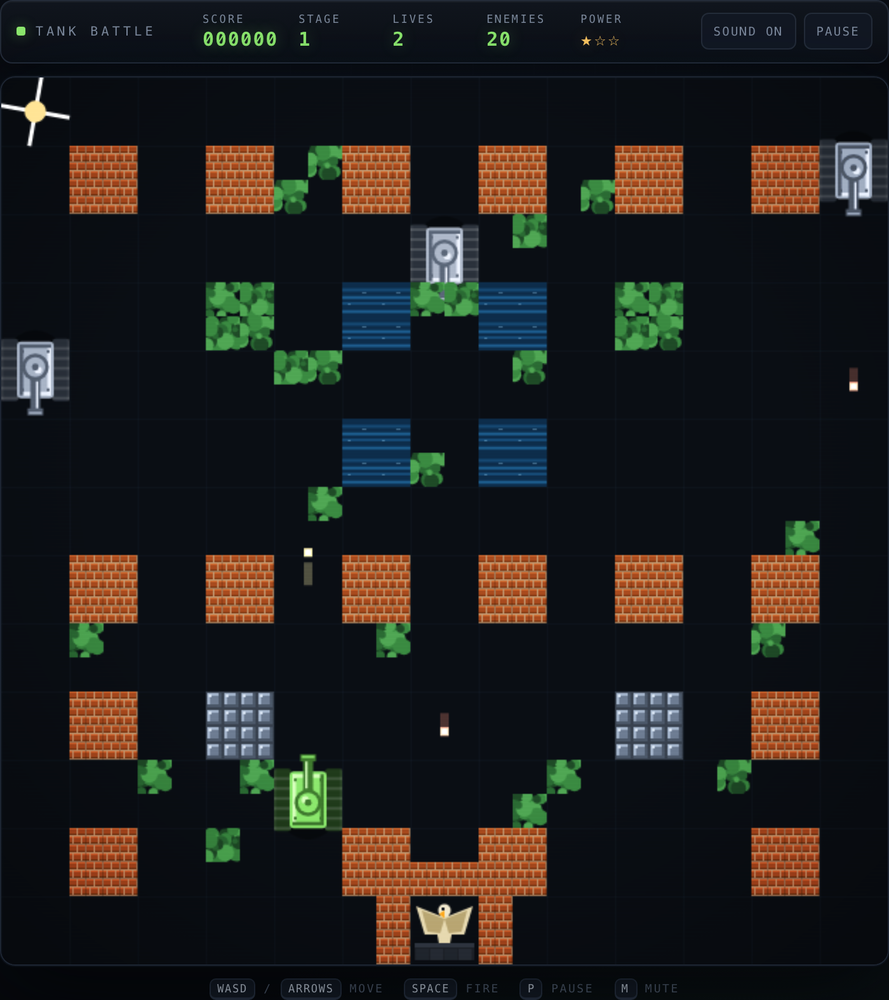

# Tank Battle

A retro arcade tank game that runs in the browser — a small homage to Namco's **Battle City** (1985), built from scratch with vanilla HTML, CSS and Canvas 2D. No frameworks, no build step, no image assets.

**[▶ Play it online](https://yoyo33hi.github.io/tank-battle/)** — no installation needed.



## Play

Open `index.html` in any modern browser — that's it.

For a local server:

```bash
git clone https://github.com/yoyo33hi/tank-battle.git
cd tank-battle
python3 -m http.server 8080
# then open http://localhost:8080
```

## Controls

| Action | Keyboard | Touch |
| --- | --- | --- |
| Move | `WASD` / arrow keys | on-screen D-pad |
| Fire | `Space` / `J` | FIRE button |
| Pause | `P` / `Esc` | PAUSE button |
| Mute | `M` | SOUND button |
| Start / restart | `Enter` | overlay buttons |

## Features

- **20 enemies per stage** across endless stages, with difficulty ramping up as you go.
- **Four enemy types** — basic, fast, power (high-velocity shells) and armor (4 HP, colour shifts as it takes damage). Flashing enemies drop power-ups.
- **Destructible terrain** — brick walls break quarter by quarter, steel blocks only yield to upgraded shells, water blocks tanks but not bullets, and tall grass hides whatever drives through it.
- **Six power-ups** — upgrade your cannon, shield yourself, call an air strike, fortify the eagle, earn an extra tank, or freeze every enemy on the field.
- **A base to defend** — lose your eagle and the run is over. Three tanks, respawn invincibility, and a high score saved to `localStorage`.
- **Juicy feedback** — screen shake, particles, synthesized WebAudio effects, and a CRT-style presentation.
- **Responsive** — keyboard on desktop, on-screen controls on touch devices, portrait and landscape layouts.
- **Zero dependencies** — just three files.

## Power-ups

| Icon | Name | Effect |
| --- | --- | --- |
| ★ | Power Up | Faster shells, then two shells and steel-piercing rounds (3 levels) |
| Shield | Shield | Temporary invincibility |
| Air Strike | Air Strike | Destroys every enemy currently on the field |
| Fortified | Fortified | Turns the brick wall around the eagle to steel for 15 seconds |
| Extra Tank | Extra Tank | One more life |
| Freeze | Freeze | Freezes all enemies for 8 seconds |

## How it works

- The playfield is a `26 × 26` tile grid (24 px tiles) rendered to a 624 × 624 canvas, updated at a fixed 60 Hz timestep.
- Brick tiles store a **4-bit quadrant mask**, so walls erode piece by piece as shells chew through them.
- Tanks move on a 24 px lattice, which keeps two-tile-wide corridors navigable, while collision is a simple AABB test against tiles and other tanks.
- Enemy AI picks candidate directions that are actually free, then biases toward the player or the eagle — with a dash of randomness so they don't all follow the same path.
- Everything is drawn procedurally: tank sprites, brick walls, the eagle, explosions. The only files are `index.html`, `style.css` and `game.js`.

## License

MIT — see [LICENSE](LICENSE).

---

## 中文说明

经典《坦克大战》的网页复刻版，纯 HTML / CSS / JavaScript 手写，无任何依赖、无构建步骤。

- 直接双击 `index.html` 即可游玩；也可以在本目录运行 `python3 -m http.server 8080`，然后访问 `http://localhost:8080`。
- 键盘：`WASD` / 方向键移动，`空格` 或 `J` 开火，`P` 暂停，`M` 静音；手机端会自动显示虚拟按键。
- 目标是守住屏幕底部的老鹰，消灭每关 20 辆敌方坦克。砖墙可以打碎，钢墙需要火力升级后才能击穿。
- 每关会随难度提升出现更多高级敌人，闪烁的敌人被击毁后会掉落道具。
